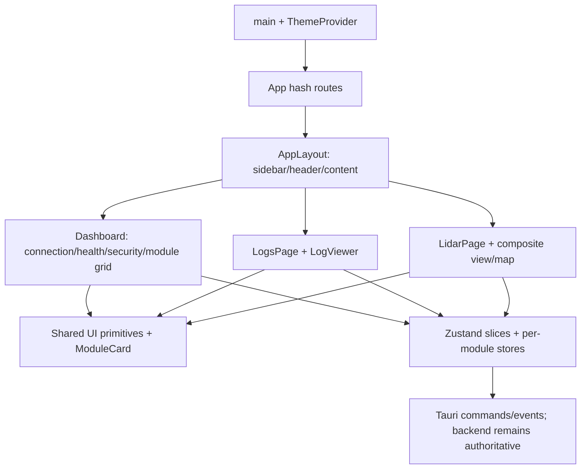

# UI architecture

## Observed structure

`UI/src/main.tsx` mounts a dark-default ThemeProvider and App. App declares three hash routes under AppLayout: Dashboard, Logs and LiDAR; each has RouteError. AppLayout owns sidebar, theme action and a shared max-width content container. Dashboard composes TransportForm, Esp32StatsCard, DeviceSecurityCard and an inline module-kind switch.

`UI/src/components/ui` contains the shared primitive layer (mainly Base UI, with a Radix slider used by PivotSlider). Application components compose these primitives. ModuleCard provides a type/UUID header and body; each family view defines its own metrics, controls, feedback and spacing.

`useModuleFront` composes transport, registry, log and auth slices. Per-module vanilla Zustand stores hold reported state and actions. UI local state holds some drafts, busy/error flags and log filters. Tauri owns physical transports and keys. No cloud UI path was found in the reviewed scope.

## Proposed boundaries

Retain React/Tauri/Zustand/Tailwind and existing module store boundaries. Add only components with demonstrated reuse:

| Layer | Proposed responsibilities | Boundaries |
|---|---|---|
| Semantic tokens and primitives | Color, typography, density, focus, theme-correct portals, input naming | No domain commands; make defaults readable before local overrides |
| Shell | Main landmark, skip/navigation behavior, route header, compact connection/auth summary | Do not duplicate connection state in local component state |
| Shared page patterns | PageHeader, SectionHeader, Empty/Loading/Error state, StatusBadge, metric row, disclosure | Present actual typed state; no invented health scores |
| ModuleCard | Display name, kind, status, exact ID details and actions | Use stable module UUID as identity; meaningful heading and control names |
| Command presentation | Capability selector, pending/error/result presentation, explicit draft/reported values | Return promises; no frontend replacement of backend auth; preserve actuator cadence unless separately chosen |
| Specialized pages | Log identity/virtualization and LiDAR coordinate/map controls | Keep heavy page-specific logic local; extract only independently testable pieces |
| Fixture/validation layer | Synthetic state cases, blocked IPC, viewport/theme evidence | Never open transport, provision keys, or require attached hardware for visual tests |

The present `PivotSlider` and `StepperDial` already have distinct interaction purposes. Do not force both into one generalized widget. Mixed Base UI/Radix usage is not by itself a defect; verify semantics and visuals at the wrapper boundary.

## UI-facing data contracts to preserve

- Registration UUID, lookup name, parent ownership, kind and routing.
- Device report versus local target/draft; null/unknown must not display as measured zero.
- Serial trust semantics and auth states on Bluetooth/Wi-Fi.
- Existing command bounds, protocol identifiers and wire misspellings.
- Log retention of newest 5,000, receipt timestamp meaning and JSON export payload.
- LiDAR pivot/grid transforms, ROI draft synchronization and child safety restrictions.

Historical compatibility contracts live in [docs/audits/architecture](../../docs/audits/architecture/compatibility-contracts.md). This UI audit does not authorize changing them.

## Upgradeability strategy

Make token and primitive changes first; establish a small state catalog; compose shared page/module anatomy second; alter action presentation with targeted tests third. Keep changes by layer and phase. Avoid rewriting working stores or introducing a new global design-framework dependency. If later evidence requires a bridge or protocol change, record a separate impact decision before extending the phase.
