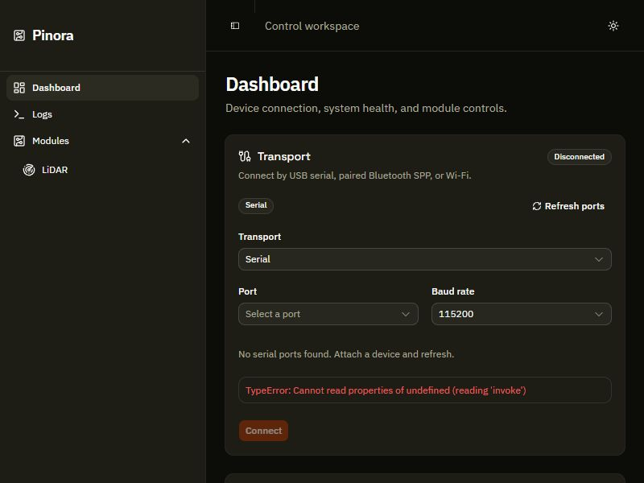
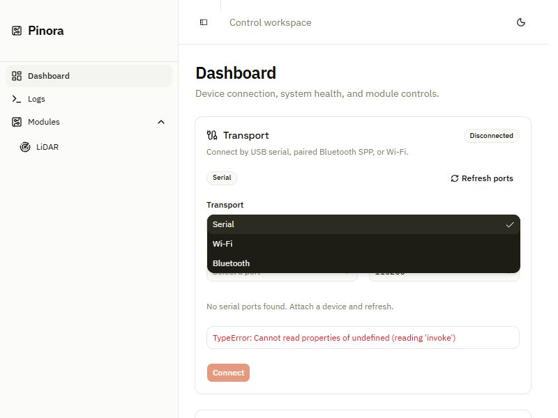
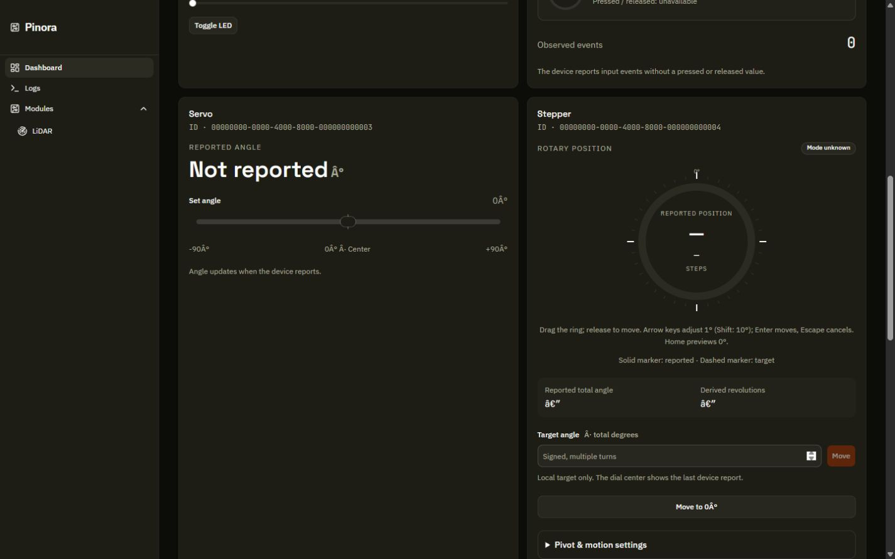

# UI audit report — Pinora

Review date: 2026-11-05. Basis: `main` at `127dd90e0428ea0d90dfd77e48712e639d386d15`, product `0.8.0-alpha`. This review is for UI beautification and usability planning. No product changes were made.

## Assessment

Pinora has a workable visual and architectural foundation: React pages, shared card/control primitives, light/dark semantic tokens, a persistent shell, typed per-module stores, bounded virtual logs, and explicit unknown telemetry. A coherent UI can be built incrementally on this stack. A framework replacement, protocol redesign, cloud migration, or firmware rewrite is not justified by this UI audit.

The current presentation combines very compact primitives (12px normal control text; 24–28px common controls; 10px badges) with roomy cards and repeated technical metadata. At 800×600, navigation and setup consume most of the useful first view. At wider sizes, empty overview cards and unequal module content create large unused areas. These are reasons to revise hierarchy and density together rather than only replacing colors.

There are **13 findings: 9 Medium and 4 Low; 0 Critical/High**. Twelve are confirmed; the bounded-log identity finding is probable. All are Open; no repairs are claimed verified. See the [canonical register](ISSUE_REGISTER.md) for exact locations and per-issue reproduction limits.

## Highest-value findings

| Finding | Evidence and implication |
|---|---|
| Light-theme helper text contrast | Opaque muted text computes to 4.260:1 on white and 3.862:1 on the muted surface. Normal active text target is 4.5:1. Improve the tokens before spreading the design. |
| Default window hierarchy | In the 800×600 browser reference, statistics begin at y=589 and module empty content at y=945. The browser-only error increases transport height; native pixels were not measured. The sidebar stays 256px wide. |
| Read-only mismatch | A synthetic Bluetooth/NoKey state displays Read-only while LED/rangefinder/RFID write actions remain enabled. This is a UI capability problem, not evidence of a backend auth bypass. |
| Silent old command paths | LED/servo discard command promises; newer families present pending/error feedback. Harmonize user-visible command results. |
| Missing LiDAR children | A LiDAR registration without the expected child lookups leaves the route body blank. A stable page header and partial-registration state are needed. |
| Slider semantics | The LED wrapper is named, but its focusable generated range input is not. Name the actual input and verify multiple LEDs. |
| Label quality | Corrupted degree/separator/range symbols render literally, and module cards omit available lookup names. |

## Visual evidence

These images are **before** evidence, not approved redesigns.

The red error in this browser image comes from absent native Tauri IPC. It is a preview limitation, not a confirmed packaged-app failure.

Synthetic screenshots use the actual views with a test-only state fixture and blocked IPC; they do not prove device operation. The harness uses a separate Vite root/config, so exact final CSS/bundle parity with the packaged app is not claimed.

## Coverage and method

| Area | Coverage | Evidence / limits |
|---|---|---|
| Routes and application shell | Full source review of App, main, AppLayout, Dashboard, LogsPage, LidarPage and RouteError | All three routes rendered; native window not launched. LiDAR is currently mounted, contrary to older README statements. |
| Visual system | Full index.css and theme-provider review | Light/dark browser dashboard; sampled contrast calculations; five font families imported, three assigned to semantic roles. |
| Domain components | Full source review of TransportForm, DeviceSecurityCard, Esp32StatsCard, ModuleCard, ParentControlledState, PivotSlider, StepperDial, LogViewer | Disconnected real preview; synthetic connected, read-only, unknown telemetry, partial LiDAR, populated logs. No device writes. |
| Module views | All nine family view files inspected | Eight standalone dashboard families plus composite LiDAR rendered. Some lower module areas were inspected via AX/DOM rather than screenshot; not every input state was exercised. |
| Shared primitives | Detailed review of card, button, input, select, slider, switch, alert and sidebar; supporting field/tabs/sheet patterns sampled | No exhaustive review of every generated primitive or third-party implementation; no dependency vulnerability audit. |
| UI-facing state and bridge | Store composition/types/registry/auth and command serializer; LED/servo action paths; log retention; Tauri window/config and relevant prior audit | Only boundary details necessary to explain UI behavior; no broad backend/firmware re-audit. |
| Tests/build | Five frontend suites, typecheck, isolated production build | 173 pass, 0 fail; build passes with non-blocking configuration/chunk warnings. |
| Prior records/user work | Existing README and engineering audit/roadmap reviewed for context; git baseline recorded | Historical findings preserved; firmware edits left untouched. |

## What is working and should survive

- Hash routing and route-level rendering error boundaries.
- Typed registration/event routing and per-module subscriptions.
- Unknown versus reported telemetry; explicit draft terminology in newer controls.
- Parent-controlled protection and read-only physical-input presentation.
- Bound/batched logs, filters, export, detail expansion and virtualization.
- Keyboard support in PivotSlider/StepperDial and LiDAR map handlers; motion-safe transitions in input views.
- Connection/authentication information, protocol mismatch and duplicate-name warnings.

## Improvement opportunities (not defects)

See [visual direction](VISUAL_DIRECTION.md) and [requirements](REQUIREMENTS.md). Prioritize readable typography, restrained accent use, less repeated UUID metadata, progressive disclosure, common status/action anatomy, route-aware headers, and content-sized module layouts. Optional features such as module search/favorites, live charts, or pause/follow logs must be justified by actual workflows and available data. No invented telemetry or unsupported orientation display.

## Proposed delivery

1. UI Phase 1 — visual foundations and readability.
2. UI Phase 2 — shell, dashboard hierarchy, and module identity.
3. UI Phase 3 — module interaction and feedback consistency.
4. UI Phase 4 — logs and LiDAR workspaces.
5. UI Phase 5 — native, accessibility, and visual completion gate.

Every phase includes its own focused regressions and before/after evidence. Phase 5 completes the cross-app matrix; it is not permission to defer all testing until the end. Full specifications are in [PHASE_PLAN.md](PHASE_PLAN.md).

## Standards and limits

Active normal-sized text uses a 4.5:1 contrast target from [W3C SC 1.4.3](https://www.w3.org/WAI/WCAG22/Understanding/contrast-minimum). [W3C SC 2.5.8](https://www.w3.org/WAI/WCAG22/Understanding/target-size-minimum) uses a 24×24 CSS-pixel minimum with exceptions, including spacing. This audit does **not** call every 20–28px control a WCAG failure; proposed 36px normal controls are a comfort/design choice. No blanket WCAG conformance claim is made.

Unverified: native Tauri/WebView sizing, CSP runtime, OS/system theme transitions, actual screen-reader behavior, all connected hardware states, long-session log rollover, real LiDAR samples/scanning, keyboard-only completion of every task, 1024px state matrix and 200% zoom. Some are planned checks; none is silently recorded as passed.

## Next step

UI Phase 0 is complete. The next implementation scope is UI Phase 1 only, as specified in the plan. The user requested an audit and phases, so this handoff does not begin product modifications.
