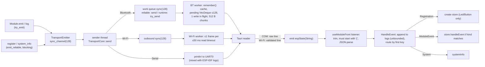

# Communication flow

End-to-end trace of commands, events and connection state, as implemented at `5b5c8ed4`.

## 1. Framing and encoding (all transports)

- Every message is one JSON document followed by `\n` (newline-delimited JSON).
- Firmware → desktop: `ProtocolMessage`, which is one of `{"Registration":{…}}`, `{"ModuleEvent":{"id":…,"event":{…}}}` or `{"System":{…}}`.
- Desktop → firmware: `IncomingCommand` `{"id":"<uuid>","command":{"<Family>":{…}}}`.
- Serde default external tagging, with exceptions: `ImuEvent` is internally tagged (`event_type`), and unit variants such as `RangefinderCommandPayload::StartRanging` serialize as bare strings.
- No version field, sequence number, acknowledgement, checksum or retry.

### Size limits (they differ by path; PIN-TPL-016)

| Path | Limit | Behavior on overflow |
|---|---|---|
| Firmware Bluetooth inbound line | 8 192 B (`MAX_MESSAGE_BYTES`) | disconnect |
| Firmware Bluetooth outbound frame | < 8 192 B | message dropped with warning |
| Firmware Bluetooth SPP write chunk | 512 B | — |
| Firmware Wi-Fi inbound line | 8 192 B | disconnect |
| Tauri Wi-Fi inbound line | 262 144 B | disconnect |
| Tauri COM (USB/SPP) inbound line | **unbounded** | — |
| Tauri Wi-Fi auth line | 512 B | reject |

## 2. Command path (LED example)

```mermaid
sequenceDiagram
  participant V as LedControls (React)
  participant S as LED store
  participant T as Tauri send_data
  participant W as Firmware transport worker
  participant L as main loop
  participant M as Ledmodule
  V->>S: onValueCommitted(80)
  S->>T: invoke("send_data", {data: '{"id":U,"command":{"Led":{"SetState":{"state":80}}}}'})
  alt COM port open (USB or SPP)
    T->>W: write data + "\n" (NOT validated)
  else Wi-Fi authenticated
    T->>T: serde parse IncomingCommand (validated)
    T->>W: re-serialized frame + "\n"
  end
  W->>W: buffer bytes until "\n", serde parse IncomingCommand
  W->>L: mpsc (sync_channel 128, blocking send)
  L->>L: try_recv (≤1 per iteration); lookup by UUID
  L->>M: dispatch → handle_command (Err ⇒ High SysLog, loop continues; Phase 1B)
  M->>M: clamp to 0–100 (+ Medium SysLog if clamped), set_duty (Phase 1B)
  M-->>L: emit Brightness{level: applied} (try_emit)
```

Unknown IDs are logged on the firmware console only. The desktop is not told. `"SSI"` is accepted and ignored.

## 3. Event / telemetry path



**Ordering.** FIFO within each queue. The firmware has one producer path per transport, so ordering is preserved end-to-end unless a message is dropped. There is no gap detection.

**Loss.** Runtime events can drop at three firmware stages. The drop is logged on the firmware console only (PIN-TPL-010). Reliable messages block instead of dropping. At the Bluetooth `pending` stage, even registrations can drop when 128 frames are queued.

**Duplication.** The replay cache sends system and registrations again on reconnect. Registration replay is idempotent for the desktop: a store is replaced with defaults, which loses displayed state (PIN-TPL-012). Runtime events are never duplicated by firmware.

## 4. Connection lifecycle

### Firmware

| Transport | Start | Connected | Disconnect | Reconnect |
|---|---|---|---|---|
| Bluetooth SPP | Bluedroid init → SPP server start → *discoverable forever* | First `ServerOpen` accepted; later ones rejected | `Close`, write failure, overflow, oversize line → clears pending/input | Desktop reopens COM → replay of system + registrations |
| Wi-Fi | **Blocks boot** until AP joined; failure aborts `main` | TCP connect + token → replay | Read 0 / error / oversize | Retry every ~2 s (drains outbound into cache meanwhile). No AP reassociation |
| Serial | stdin reader thread | Always "connected" | n/a | No replay; registrations only at boot |

### Desktop

| Action | Sequence |
|---|---|
| Connect Serial | `Disconnect()` → install listeners → `start_port` (open, DTR low, RTS pulse 100 ms, which **may reset board**) → on success clear registry and logs (race, PIN-TPL-012) |
| Connect Bluetooth | `Disconnect()` → clear registry and logs → listeners → `start_bluetooth_port` (validate port via PnP, open at 115200, no DTR/RTS) |
| Start Wi-Fi | `Disconnect()` → clear → listeners → `start_wifi_listener(port)` |
| Device loss | Bluetooth read error → `bluetoothConnection: Disconnected` → UI error state. Wi-Fi drop → `wifiConnection: Disconnected` → back to Listening, registry cleared. **USB read error → nothing; UI still "Connected"** |
| Disconnect | Clear registry → `stop_port` → `stop_wifi_listener` → remove listeners (logs retained) |

## 5. Trust boundaries

```
[nearby radio peer] --SPP (Just Works, no app auth)--> firmware      ← PIN-TPL-003
[LAN peer with token] --TCP plaintext--> Tauri listener ⇄ firmware   ← PIN-TPL-013
[firmware / UART noise] --raw lines--> Tauri COM reader --> React    ← PIN-TPL-006
[WebView script] --invoke send_data (CSP off)--> serial/TCP           ← PIN-TPL-023
```

The firmware's only input validation is Serde's type check. There are no semantic range checks (PIN-TPL-002, -004, -005, -019).

## 6. Cross-language consistency (Rust ↔ TypeScript)

| Family | Rust events / commands | TS schema | TS dispatch | Mismatch notes |
|---|---|---|---|---|
| Led | `Brightness{level:u32}` / `SetState{state:u32}`, `Toggle{}` | ✓ (`z.number()`, no bounds) | ✓ | TS allows non-integers and negatives; Rust rejects them at serde (good) |
| Button | `Ckick{}` | ✓ | ✓ | — |
| SysLog | `{text, raw_err: Option<String>, priority}` | ✓ (`nullable`) | logs only | Emitter-level logs use source id `"log"` |
| Servo | 4 events / 3 commands | in `servo.tsx` only | ✗ | not registered |
| Lidar | 4 events / 7 commands | in `lidar.tsx` only | ✗ | README wrongly says strings; code uses `{}` objects (consistent with Rust) |
| Rangefinder | 5 events / 4 commands | in `rangefinder.tsx` | ✗ | `StartRanging`/`StopRanging` are bare strings on both sides (consistent, but unlike siblings) |
| StepperMotor | 6 events / 7 commands | in `stepper.tsx` | ✗ | TS bounds `±f32::MAX`; firmware accepts any finite f32 |
| Imu | internally tagged `event_type` | `discriminatedUnion("event_type")` | ✗ | — |
| Rfid | 3 events / 3 commands | in `rfid.tsx` | ✗ | — |
| RemoteReceiver | `Click{key}` | in `remote-receiver.tsx` | ✗ | — |

The aggregate schemas (`UI/src/lib/protocol/*.ts`) are not used on the receive path, so these per-file schemas are documentation in practice (PIN-TPL-007).
