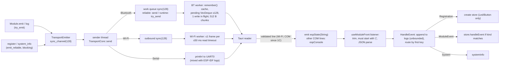

# Communication flow

End-to-end trace of commands, events and connection state, as implemented at `5b5c8ed4`. Later phases annotate the sections they change; Phase 2A changes are marked **2A**.

## 1. Framing and encoding (all transports)

- Every message is one JSON document followed by `\n` (newline-delimited JSON).
- Firmware → desktop: `ProtocolMessage`, which is one of `{"Registration":{…}}`, `{"ModuleEvent":{"id":…,"event":{…}}}` or `{"System":{…}}`.
- Desktop → firmware: `IncomingCommand` `{"id":"<uuid>","command":{"<Family>":{…}}}`.
- Serde default external tagging, with exceptions: `ImuEvent` is internally tagged (`event_type`), and unit variants such as `RangefinderCommandPayload::StartRanging` serialize as bare strings.
- No version field, sequence number, acknowledgement, checksum or retry. **2A:** protocol v1 adds `SystemInfo.protocol_version` (`1`; absent means `0`), shown by the desktop with a mismatch warning. There is still no sequence number, acknowledgement, checksum or retry.

### Size limits (they differ by path; PIN-TPL-016)

| Path | Limit | Behavior on overflow |
|---|---|---|
| Firmware Bluetooth inbound line | 8 192 B (`MAX_MESSAGE_BYTES`) | disconnect |
| Firmware Bluetooth outbound frame | < 8 192 B | message dropped with warning |
| Firmware Bluetooth SPP write chunk | 512 B | — |
| Firmware Wi-Fi inbound line | 8 192 B | disconnect |
| Tauri Wi-Fi inbound line | 262 144 B | disconnect |
| Tauri COM (USB/SPP) inbound line | **unbounded** | — |
| Tauri Wi-Fi auth line | 512 B | reject |

**2B.** One framer and limit table for every path (`protocol/src/framing.rs`, PIN-TPL-016): 8 192 B per line everywhere, in both directions. The Tauri COM reader is bounded (an oversized line is discarded); Tauri Wi-Fi disconnects above 8 192 B (was 262 144 B); a firmware frame over the limit is dropped and counted. The device caps the Wi-Fi token reply at 18 B; the desktop gives a peer 5 s in total for its token line.

## 2. Command path (LED example)

```mermaid
sequenceDiagram
  participant V as LedControls (React)
  participant S as LED store
  participant T as Tauri send_data
  participant W as Firmware transport worker
  participant L as main loop
  participant M as Ledmodule
  V->>S: onValueCommitted(80)
  S->>T: invoke("send_data", {data: '{"id":U,"command":{"Led":{"SetState":{"state":80}}}}'})
  alt COM port open (USB or SPP)
    T->>W: write data + "\n" (NOT validated)
  else Wi-Fi authenticated
    T->>T: serde parse IncomingCommand (validated)
    T->>W: re-serialized frame + "\n"
  end
  W->>W: buffer bytes until "\n", serde parse IncomingCommand
  W->>L: mpsc (sync_channel 128, blocking send)
  L->>L: try_recv (≤1 per iteration; 2C: ≤16 per 1 ms period, or wakes on arrival); lookup by UUID
  L->>M: dispatch → handle_command (Err ⇒ High SysLog, loop continues; Phase 1B)
  M->>M: clamp to 0–100 (+ Medium SysLog if clamped), set_duty (Phase 1B)
  M-->>L: emit Brightness{level: applied} (try_emit)
```

Unknown IDs are logged on the firmware console only. The desktop is not told. `"SSI"` is accepted and ignored.

**2A.** Dispatch order: `"SSI"` (`System(Rediscover)` returns to the main loop, anything else is ignored) → top-level module id → a composite's child (`child_mut`, e.g. the LiDAR's `servo_x`, `servo_y`, `rangefinder`) → unknown. The frontend validates every command with `IncomingCommandSchema` before `send_data`.

## 3. Event / telemetry path



**Ordering.** FIFO within each queue. The firmware has one producer path per transport, so ordering is preserved end-to-end unless a message is dropped. There is no gap detection.

**Loss.** Runtime events can drop at three firmware stages. The drop is logged on the firmware console only (PIN-TPL-010). Reliable messages block instead of dropping. At the Bluetooth `pending` stage, even registrations can drop when 128 frames are queued.

**2B.** Drops are counted per stage (emitter queue, transport queue, link) instead of logged one by one, and the sender thread reports them as one Medium SysLog from `"log"` every 5 s. Queue-full is no longer an error. IMU samples are coalesced to 20/s per stream; rangefinder errors and LiDAR step logs are limited to 1/s with a suppressed count. Wi-Fi has a reader thread and a writer loop per connection, so outbound frames are no longer capped at one per 50 ms read timeout.

**Duplication.** The replay cache sends system and registrations again on reconnect. Registration replay is idempotent for the desktop: a store is replaced with defaults, which loses displayed state (PIN-TPL-012). Runtime events are never duplicated by firmware.

**2A.** The desktop now validates each `espState` message with Zod `ProtocolMessageSchema` (all families) and drops, with a console error, any that do not match. A re-sent registration for a known id and kind keeps the existing store. After each connect the desktop sends `Rediscover`, and the firmware re-sends the system snapshot, all registrations and each module's current state (`first_emit`: LED brightness, stepper mode and pivot limits, LiDAR ROI), on every transport including Serial. Duplicate lookup names are reported by the firmware (Medium SysLog) and the desktop (warning in the statistics card).

## 4. Connection lifecycle

### Firmware

| Transport | Start | Connected | Disconnect | Reconnect |
|---|---|---|---|---|
| Bluetooth SPP | Bluedroid init → SPP server start → discoverable and pairing accepted for 120 s, then connectable only (Phase 1C) | First `ServerOpen` accepted; later ones rejected | `Close`, write failure, overflow, oversize line → clears pending/input | Desktop reopens COM → replay of system + registrations |
| Wi-Fi | **Blocks boot** until AP joined; failure aborts `main`. **2B:** background link thread, backoff 2–30 s; boot never waits | TCP connect + token → replay. **2B:** then device session (handshake on request) | Read 0 / error / oversize | Retry every ~2 s (drains outbound into cache meanwhile). No AP reassociation. **2B:** reassociates after a drop |
| Serial | stdin reader thread. **2B:** the USB console reader runs in every image (pairing); in the Serial image it is also the command source | Always "connected" | n/a | No replay cache; registrations at boot and, since 2A, on `Rediscover` |

### Desktop

| Action | Sequence |
|---|---|
| Connect Serial | `Disconnect()` → install listeners → `start_port` (open, DTR low, RTS pulse 100 ms, which **may reset board**) → on success clear registry and logs (race, PIN-TPL-012). **2A:** clear first, then listeners → `start_port` → `Rediscover` |
| Connect Bluetooth | `Disconnect()` → clear registry and logs → listeners → `start_bluetooth_port` (validate port via PnP, open at 115200, no DTR/RTS). **2A:** then `Rediscover`. **2B:** the backend sends `AuthBegin` as soon as its reader runs and reports `deviceAuth` (`Pending` → `Authenticated` / `NoKey` / `Unprovisioned` / …) |
| Start Wi-Fi | `Disconnect()` → clear → listeners → `start_wifi_listener(port)`. **2A:** `Rediscover` on each `wifiConnection: Connected`. **2B:** accept thread + per-peer token worker (5 s deadline, ≤ 4 pending); the newest authenticated device replaces the old one; then `AuthBegin` as for Bluetooth |
| Device loss | Bluetooth read error → `bluetoothConnection: Disconnected` → UI error state. Wi-Fi drop → `wifiConnection: Disconnected` → back to Listening, registry cleared. **USB read error → nothing; UI still "Connected"**. **2A:** USB read error → `serialConnection: Disconnected` → UI error state, registry cleared |
| Disconnect | Clear registry → `stop_port` → `stop_wifi_listener` → remove listeners (logs retained) |
| Pair (2B) | Connect over USB serial → `provision_device_key` → device answers `Auth(Key)` on its USB console → backend stores it (`device-keys.json`) and emits `deviceAuth: Paired`. `clear_device_key` → `Auth(KeyCleared)` → key removed on both sides |

## 5. Trust boundaries

```
[nearby radio peer] --SPP (Just Works within 120 s window, no app auth)--> firmware  ← PIN-TPL-003 (window: 1C; auth: 2B)
[LAN peer with token] --TCP plaintext--> Tauri listener ⇄ firmware   ← PIN-TPL-013
[firmware / UART noise] --> Tauri COM reader (validates; others → espConsole) --> React  ← PIN-TPL-006 (fixed 1C)
[WebView script] --invoke send_data (CSP off)--> serial/TCP           ← PIN-TPL-023
```

**2B.**

```
[radio / LAN peer] --AuthBegin/Challenge/AuthResponse (mutual HMAC-SHA256)--> device session
    keyed device: read-only until authenticated, then signed commands only (seq + MAC)
    device without a key: open, warns once per connection
[USB cable (physical access)] --ProvisionKey / ClearKey--> USB console → NVS key  (never over radio)
[Tauri backend] holds keys (device-keys.json); Auth lines never reach the WebView
[WebView script] --send_data--> backend validates, refuses reserved system commands, signs
```

Remaining gaps: Wi-Fi traffic is unencrypted (telemetry readable, token observable); USB serial is trusted without a handshake; keys are plain JSON in the user's app data directory; a WebView script can still send any module command through `send_data` (PIN-TPL-023).

The firmware's only input validation is Serde's type check. There are no semantic range checks (PIN-TPL-002, -004, -005, -019).

## 6. Cross-language consistency (Rust ↔ TypeScript)

| Family | Rust events / commands | TS schema | TS dispatch | Mismatch notes |
|---|---|---|---|---|
| Led | `Brightness{level:u32}` / `SetState{state:u32}`, `Toggle{}` | ✓ (`z.number()`, no bounds) | ✓ | TS allows non-integers and negatives; Rust rejects them at serde (good) |
| Button | `Ckick{}` | ✓ | ✓ | — |
| SysLog | `{text, raw_err: Option<String>, priority}` | ✓ (`nullable`) | logs only | Emitter-level logs use source id `"log"` |
| Servo | 4 events / 3 commands | in `servo.tsx` only | ✗ | not registered |
| Lidar | 4 events / 7 commands | in `lidar.tsx` only | ✗ | README wrongly says strings; code uses `{}` objects (consistent with Rust) |
| Rangefinder | 5 events / 4 commands | in `rangefinder.tsx` | ✗ | `StartRanging`/`StopRanging` are bare strings on both sides (consistent, but unlike siblings) |
| StepperMotor | 6 events / 7 commands | in `stepper.tsx` | ✗ | TS bounds `±f32::MAX`; firmware accepts any finite f32 |
| Imu | internally tagged `event_type` | `discriminatedUnion("event_type")` | ✗ | — |
| Rfid | 3 events / 3 commands | in `rfid.tsx` | ✗ | — |
| RemoteReceiver | `Click{key}` | in `remote-receiver.tsx` | ✗ | — |

The aggregate schemas (`UI/src/lib/protocol/*.ts`) are not used on the receive path, so these per-file schemas are documentation in practice (PIN-TPL-007).

**2A.** The aggregate schemas now include every family above plus `System` commands, and are used on both paths: `ProtocolMessageSchema` on receive, `IncomingCommandSchema` on send. `UI/tests/protocol-fixtures.test.ts` parses every line of the Rust golden fixture and checks family coverage, so drift on either side fails a test. The schemas are still hand-written (code generation deferred). Stores and dispatch exist only for Led and Button.

**Floating-state audit (2026-11-05).** Stores and dispatch now exist for every family with a desktop module (PIN-TPL-033). Each module with state replays it in `first_emit`, and values start as `null` on the desktop until reported (PIN-TPL-032).
