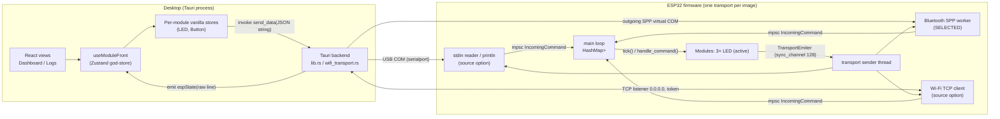

# Current system — as implemented at commit `5b5c8ed4`

> **Historical baseline.** Phase 0 later moved files without changing behavior. For the current paths, see the path map in [phases/phase-0/RESULT.md](../phases/phase-0/RESULT.md) §2. This document will be refreshed by the post-Phase-0 reassessment.

This document describes the code as it actually exists. It is not based on older READMEs or plans. Where the repository-root `README.md` or `docs/architecture-audit.md` disagree with the code, the code wins, and the disagreement is recorded as PIN-TPL-024.

## 1. Repository boundary

| Fact | Value |
|---|---|
| Template path | `C:\Dev\Pinora\Pinora_Templat` (folder name intentionally lacks the final "e") |
| Git root | `C:/Dev/Pinora/Pinora_Templat` (its own repository) |
| Parent `C:\Dev\Pinora` | **Not** a Git repository |
| Branch at audit | `main`, up to date with `origin/main`, clean working tree |
| HEAD | `5b5c8ed435936ed4e23b3d59e36023f25e2ad694`, "feat: prepare Pinora v0.8.0-alpha multi-transport milestone", 2026-10-08 |
| Other local branches | `feat/electrobun-architecture`, `migration/slint-ui-protocol-workspace`, `rescue/broken-main` (not audited) |
| Remotes | `origin` (HTTPS) and `upstream` (SSH), both `github.com/Adeun-Ilemobola/Pinora_Templat` |
| Tags | none |
| Tracked files | 149 (≈ 21.6 k lines including lockfiles; ≈ 14 k authored) |
| Sibling projects (not audited) | `2dLidar`, `pinora_cli`, `pinora_studio`, `UI` |

## 2. Packages

There is **no root Cargo workspace**. There are four independent build units:

| Package | Path | Kind | Toolchain | Depends on |
|---|---|---|---|---|
| `Firmware_Templates` | `Firmware_Templates/` | ESP32 `std` binary (ESP-IDF 5.5.3, Xtensa `xtensa-esp32-espidf`) | `esp-1.93` (pinned by `rust-toolchain.toml`) | `pinora-protocol` (path), `esp-idf-svc/hal/sys` (Git-patched; lockfile-pinned), `embedded-hal(-bus,-compat)`, `pwm-pca9685`, `vl53l1x-uld`, `mfrc522`, `uuid`, `serde(_json)`, `anyhow`, `log` |
| `pinora-protocol` | `protocol/` | Rust library (edition 2024) | host stable | `serde`, `serde_json` |
| `ui` / `ui_lib` | `UI/src-tauri/` | Tauri 2 desktop backend | host stable | `pinora-protocol` (path), `tauri`, `serialport`, `tauri-plugin-log`, `tauri-plugin-opener`, `chrono` |
| `ui` (frontend) | `UI/` | React 19 + Vite 8 + TypeScript 6 (Bun) | Bun 1.4 | Zustand 5, Zod 4, React Router 8, Base UI / shadcn components, TanStack Virtual |

Convenience recipes live in the `justfile`, which needs Windows PowerShell for some recipes. The template metadata files `pinora.toml`, `.espConfig/esp_config.json` and `Firmware_Templates/pre-script.rhai` have no consumer inside this repository. They may be consumed by external tools (see contract C-10).

## 3. Runtime components

### 3.1 Firmware (`Firmware_Templates/src`)

| File | Role | Status |
|---|---|---|
| `main.rs` | Boot: ESP-IDF patches and logger, `Peripherals::take`, UART0 console driver (raw `sys`), selects `TransportType::Bluetooth`, emits system info, builds I²C bus and `HardwareContext`, constructs 3 LEDs, registers modules, runs the main loop | Active; ~130 lines of commented-out wiring for other modules |
| `core/modulecore.rs` | `ModuleCore` (UUID v4, type, lookup name, parent ID, emitter) and the `Module` trait (`tick`, `handle_command`, `register`, `first_emit`, `emit`, `log`) | Active |
| `core/hardware.rs` | GPIO wrappers (`OutputPinCore`, `InputPinCore`), `now_us`, `TimerState` (deadline polling), shared-bus type aliases, `HardwareContext` (LEDC timer 5 kHz / 13-bit; I²C bus; PCA9685 creation commented out), `print_esp_system_info` | Active |
| `core/transport/transport_core.rs` | `TransportCore`: constructs the selected transport, spawns the sender thread (emitter → transport), returns the command `Receiver`; Serial stdin reader | Active |
| `core/transport/transport_emiter.rs` | `TransportEmiter`: `emit_reliable` (blocking `send`) for system/registration, `try_emit` (drop on full) for runtime events | Active |
| `core/transport/bluetooth.rs` | Bluedroid Classic SPP server: GAP/SPP callbacks → bounded work queue → worker thread (framing, parsing, chunked writes, congestion, reconnect replay cache) | **Active (selected)** |
| `core/transport/wifi.rs` | Station connect (blocking at boot), TCP client with token handshake, reconnect loop, replay cache | Compiled, not selected |
| `core/emitter.rs` | Earlier println-based emitter | **Dead**: not in the module tree (`core/mod.rs:3` commented out) |
| `module/ledmodule.rs` | LEDC PWM LED: `SetState{0..100}`, `Toggle`; emits `Brightness` | **Active ×3** |
| `module/buttonmodule.rs` | Debounced GPIO input; emits `Ckick` on each committed edge | Compiled, not instantiated |
| `module/servomodule.rs` | PCA9685 servo with offset/pivot limits | Compiled, not instantiated |
| `module/stepper.rs` | 4-wire or 74HC595 half-step stepper with homing and pivot modes | Compiled, not instantiated |
| `module/lidar.rs` | Composite: 2 servos + VL53L1X; raster scan producing chunked point maps | Experimental, not instantiated |
| `module/range_finder.rs` | VL53L1X ranging and configuration | Compiled, not instantiated |
| `module/imu/*` | MPU-6500/9250/9255 identification, bias calibration, gyro/accel events | Compiled, not instantiated |
| `module/rfid.rs` | MFRC522 read/write with RGB LED and buzzer | Compiled, not instantiated |
| `module/remote_receiver.rs` | NEC IR decode by GPIO polling | Compiled, not instantiated |
| `module/joystick.rs` | 2-axis ADC + button | Compiled, not instantiated |
| `utilities/math.rs` | `range_*` linear mappings, `constrain_*`, `pulse_us_to_tick` (PCA9685 ≈ 60 Hz) | Active (LED uses `range_u32`) |

**State ownership.** The main thread owns `Peripherals`, every driver, and the `HashMap<String, Box<dyn Module>>`. Shared buses use `Rc<RefCell<…>>` and `embedded_hal_bus::i2c::RcDevice`. They are single-threaded by construction, which is correct because modules never leave the main thread. Cross-thread data moves only through `mpsc` channels. The single `Arc<Mutex<Option<Core>>>` in `TransportCore` is locked by the sender thread and once at startup.

**Threads.** There is the main task, the transport sender thread (`std::thread::spawn`, default pthread stack 4 KiB per `sdkconfig.defaults`), the Bluetooth or Wi-Fi worker (8 KiB stack), and the Serial stdin reader when Serial is selected. ESP-IDF's Bluedroid and Wi-Fi tasks invoke callbacks that only copy and enqueue.

**Scheduling.** The main loop is cooperative and busy-polling, with a 1 ms yield after ≥ 650 ms (PIN-TPL-009). Each iteration ticks every module in `HashMap` order, which is unspecified, and then processes at most one command.

**Error handling.** Tick errors are discarded. Handler errors terminate `main` (PIN-TPL-001). Constructors return `anyhow::Result`; some modules use `Result<_, ()>` mapped to `ModuleError::OperationFailed`. There are several `.unwrap()` calls in inactive actuator paths (PIN-TPL-004).

**Unsafe code.** There are seven `unsafe` sites: UART driver install, `esp_timer_get_time`, heap/flash/partition queries, `modem.reborrow()`, the `from_raw_parts` copy of SPP data (null-checked, copied before return), and two GAP security calls. No soundness defect was found. Each site is a short FFI call with checked inputs. The ownership bypass in UART0 is recorded as PIN-TPL-026.

### 3.2 Shared protocol (`protocol/src`)

Serde types shared by firmware and the Tauri backend. They are the authoritative wire format: newline-delimited JSON, mostly externally-tagged enums. See [communication-flow.md](communication-flow.md) and [compatibility-contracts.md](compatibility-contracts.md). The crate also holds `bluetooth_config.rs` (SPP name and size limits) and declares `wifi_config`, which is an **untracked local file** containing Wi-Fi credentials and the dev token. The tracked template is `wifi_config.example.rs`. The local file exists on this machine, and this audit did not read it.

### 3.3 Desktop backend (`UI/src-tauri/src`)

| File | Role |
|---|---|
| `lib.rs` | `AppState` (one COM port + reader thread). Commands: `greet`, `start_port`, `get_available_ports`, `get_available_bluetooth_ports` (serialport ∩ Windows PnP `BTHENUM` via PowerShell CIM), `start_bluetooth_port`, `send_data` (COM first, else Wi-Fi), `stop_port`, `start_wifi_listener`, `stop_wifi_listener`, `get_wifi_listener_status`. Emits `espState` (raw line) and `bluetoothConnection` |
| `wifi_transport.rs` | `WifiTransport`: non-blocking accept loop on `0.0.0.0:<port>`, `PINORA-AUTH 1 <token>` handshake, validates every inbound line as `ProtocolMessage` and every outbound command as `IncomingCommand`. Emits `espState` and `wifiConnection` |
| `main.rs` | Calls `ui_lib::run()` |

All commands are synchronous (PIN-TPL-014). Capabilities: `core:default`, `opener:default`, `log:default`. CSP is disabled (PIN-TPL-023).

### 3.4 Desktop frontend (`UI/src`)

| Area | Files | Role |
|---|---|---|
| Entry | `main.tsx`, `App.tsx` | Console → Tauri log forwarding; hash router with `/` (Dashboard) and `/logs`; `/lidar` route commented out |
| Central store | `lib/Modulefront.TS` | `useModuleFront`: transport mode and status, listeners, connect/disconnect flows, `ModuleRegistry` (UUID → vanilla store), `LookUpId` (name → UUID), `logs` (unbounded), `systemInfo` |
| Commands | `lib/IncomingCommand.ts` | `JSON.stringify({id, command})` → `invoke("send_data")` |
| Protocol schemas | `lib/protocol/*.ts` + module files | Handwritten Zod; aggregate covers LED/Button/SysLog only; **not used for receive validation** |
| Module UIs | `lib/Modules/*.tsx` | LED and Button are registered. Servo, Stepper, LiDAR, Rangefinder, RFID, IMU and RemoteReceiver are compiled but not registered |
| Views | `page/Dashboard.tsx`, `page/LogsPage.tsx`, `page/LidarPage.tsx` (unrouted), `components/*` | Transport card, ESP32 stats card, module cards, virtualized log viewer |
| Dead | `lib/ModuleGeter.ts` | No importers |
| UI kit | `components/ui/*` | shadcn/Base UI primitives (generated-style code; not audited for design) |

## 4. Functionality classification

| Class | Items |
|---|---|
| **Verified active (this audit)** | Protocol crate compiles; clippy runs clean except 1 warning. Tauri backend compiles; clippy runs clean except 2 warnings. Frontend type-checks. Protocol JSON shapes as listed in the [validation baseline](../evidence/validation-baseline.md). *No runtime or hardware behavior was verified by this audit.* |
| **Implemented, unverified** | Bluetooth SPP transport end-to-end (maintainer-reported working). 3× LED control and brightness events. Desktop Serial/Bluetooth/Wi-Fi connection flows. Reconnect replay of registrations (Bluetooth/Wi-Fi). Windows Bluetooth COM discovery. Log viewer. Firmware build with `esp-1.93`, previously reported passing and not re-run here |
| **Implemented but inactive** | Wi-Fi and Serial firmware transports; Button, Servo, Stepper, Rangefinder, IMU, RFID, RemoteReceiver, Joystick modules |
| **Experimental** | LiDAR composite module (firmware) and LiDAR page/playground (frontend, unrouted) |
| **Deprecated / legacy** | `Firmware_Templates/src/core/emitter.rs` (uncompiled), `.espConfig/esp_config.json` (stale commands), `UI/src/lib/ModuleGeter.ts` (unused), `greet` command, `TransportType::None` in the dead emitter |
| **Incomplete scaffolding** | `SSI` rediscovery branch (empty), `first_emit` hook (unused by LED), `init_wifi`/`init_bluetooth` stubs in the dead emitter, `LedCluster` module type (enum only), `RangefinderEvent::InvalidMeasurement` and `LidarEvent::Target` (never emitted), `StepperMotorEvent::GetOrigin` (never emitted), PCA9685 creation (commented out) |
| **Documentation-only / planned** | Project generation (no generator in this repo; `pre-script.rhai` variables only); multi-chip support (`pre-script.rhai` lists 10 targets; only `esp32` configured); LiDAR scan visualization; broader module UI coverage |

## 5. Generated and build-output paths (not architecture)

`UI/node_modules/`, `UI/dist/`, `UI/src-tauri/gen/`, `**/target/`, `Firmware_Templates/.embuild/`, the `C:/t` firmware target dir, `protocol/Cargo.lock` (ignored), and `Firmware_Templates/sdkconfig*` (ignored) are all generated output. Tracked lockfiles: `Firmware_Templates/Cargo.lock`, `UI/src-tauri/Cargo.lock`, `UI/bun.lock`.

## 6. Architectural strengths to preserve

1. **One Rust protocol crate shared by firmware and backend.** It is the right foundation for contract generation (PIN-TPL-007).
2. **Peripheral ownership through `esp-idf-hal` types.** Drivers are owned by modules and buses are shared through `RcDevice`, so pin double-use is mostly a compile error.
3. **ESP-IDF callbacks do minimal work.** The Bluetooth GAP/SPP callbacks only copy and enqueue. Parsing, writing and state live in a worker thread with explicit overflow handling (disconnect to resynchronize).
4. **Bounded firmware queues and explicit size limits.** These include the 8 KiB command cap, 512 B SPP chunks, and one write in flight with congestion tracking.
5. **The reliable/lossy emission split** (`emit_reliable` vs `try_emit`) is a sound idea and keeps module ticks from blocking on telemetry.
6. **Reconnect replay** of system and registration messages on Bluetooth and Wi-Fi.
7. **Wi-Fi path validates both directions with the shared Rust types.** It is the model for the other transports.
8. **No `unsafe` misuse found.** The FFI sites are narrow and checked.
9. **The frontend's per-module vanilla stores** isolate re-renders, and the log viewer is virtualized.
10. **Honest, detailed project documentation.** The existing README already records most limitations.

Do **not** change these during Phase 0 except to document them.
