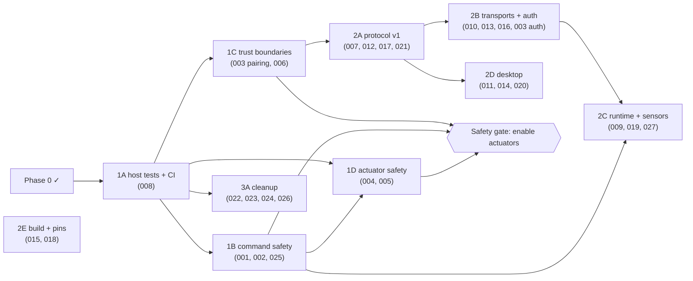

# Post-Phase-0 reassessment — Pinora Template

| Field | Value |
|---|---|
| Date | 2026-10-31 |
| Code basis | branch `phase-0/structural-reorganization` @ `a2204b33` (Phase 0 result). `main` is unchanged at `5b5c8ed4` |
| Operation | Reassessment only: read, verify, document. **No source changes**, and no commits for this operation |
| Hardware | None used |

## 1. Method

1. Re-located the evidence for every one of the 26 findings in the reorganized tree. Each record now has a **"Current location (after Phase 0)"** row.
2. Re-read the files Phase 0 created or rewrote: `board/`, `runtime/`, `core/hardware/*`, `core/transport/{manager,serial,discovery_cache}.rs`, the Tauri `commands`/`serial_transport`/`bluetooth_ports`, and the frontend `Modules/*/{schema,store,view}` and `registry/`. The goal was to catch anything the reorganization introduced.
3. Read the frontend files the initial audit had only skimmed: `AppLayout.tsx`, `theme-provider.tsx`, `use-mobile.ts`, and listener and animation-frame cleanup in `PivotSlider.tsx`, `StepperDial.tsx` and `lidar/view.tsx`.
4. Re-rated severity where the remaining impact had changed.

## 2. Results

### Which problems remain

All 26 original findings still exist in substance. This was expected: Phase 0 was structural by design. Every High finding (001–006) is present unchanged at its new location.

### Which structural problems were resolved (fully or partly)

| Finding | Resolved by Phase 0 | Still open |
|---|---|---|
| 008 | Characterization tests for the wire format and log helpers | Firmware host tests, CI, test scripts |
| 015 | `Modulefront.TS` case | `wifi_config`, `C:/t`, Git patch pins, unused deps |
| 016 | Dead files, duplicate `remember()`, commented wiring in `main.rs` | Four framing implementations with different limits; dead-receiver fallback |
| 018 | Pin map and strapping-pin warning in `board/mod.rs` | Wiring is still code; LED1 still on GPIO12 |
| 020 | 948-line mixed files split into schema/store/view | God store, `any` typing |
| 021 | All internal misspellings | Wire names (frozen) |
| 022 | rustfmt clean | Lint warnings, enforcement |
| 024 | Stale paths and the LiDAR schema statement | `fake-lidar` statement (new), legacy metadata, external-agent references |
| 026 | Ownership invariant documented | Not enforced |

None is fully Resolved, so statuses stay **In Progress**.

### New problems introduced by Phase 0

**None found.** Checked specifically:
- **Startup order and drop order:** `main.rs` vs baseline, unchanged.
- **The `Modulefront` ↔ module import cycle:** unchanged, because the factory map was deliberately left inside `RegistrationEvent`.
- **Re-export collisions from `index.ts`:** none (`tsc` clean).
- **`export` widening:** `Clamp` and `GridCells` in `lidar/geometry.ts` are harmless.
- **Line endings:** preserved per file.

### Newly discovered (pre-existing) problems

| ID | Severity | Summary |
|---|---|---|
| **PIN-TPL-027** | Low | The registry is a `HashMap` with randomized hashing, so tick, registration and replay order differ on every boot. Visible now that `board/mod.rs` makes construction order look meaningful |
| PIN-TPL-024 (extended) | Low | The README says the LiDAR route inserts a `fake-lidar` module; no such code exists |

### Severity changes

| Finding | Before | After | Reason |
|---|---|---|---|
| PIN-TPL-016 | Medium | **Low** | What remains is framing duplication, already covered behaviorally by 007/010, and two `TransportType` enums that are not real duplicates (different crates, different meanings) |

There are no other changes. The four High findings on the [Critical watch-list](../findings/critical.md) stay High, because the actuator code is still not instantiated.

**Totals: 0 Critical · 6 High · 13 Medium · 8 Low = 27** (19 Open, 8 In Progress, 0 Resolved).

### Remediation dependencies

### Is the code organized enough for controlled repairs?

**Yes, with one prerequisite.**
- **Firmware.** Each fix now has an obvious home: dispatch in `runtime/`, LED in `modules/actuators/led.rs`, Bluetooth in `core/transport/bluetooth.rs`. The pure parts (`math.rs`, `core/module.rs`, `emitter.rs`, `discovery_cache.rs`) do not depend on ESP-IDF, so they can be compiled on the host. Nothing compiles them there yet, and that is exactly what Phase 1A fixes. Without 1A, firmware fixes could only be verified on hardware.
- **Desktop.** Already testable: the golden tests and Bun tests exist.

## 3. Roadmap

See [phases/ROADMAP.md](../phases/ROADMAP.md). It has ten subphases (1A–1D, 2A–2E, 3A), each with objective, linked findings, affected files, strategy, behavioral impact, risk, verification, completion criteria, recovery and dependencies. Exceptions to strict severity order are explained there.

## 4. Limitations

- No hardware or runtime verification, as before.
- External consumers of the template (`pinora_cli`, `pinora_studio`) are still uninspected, so contracts C-01, C-08 and C-10 remain conservatively frozen.
- Branches other than `main` and the Phase 0 branch were not reviewed.
